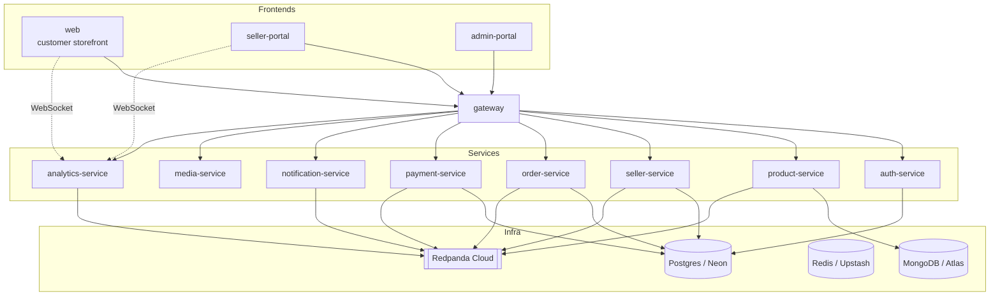
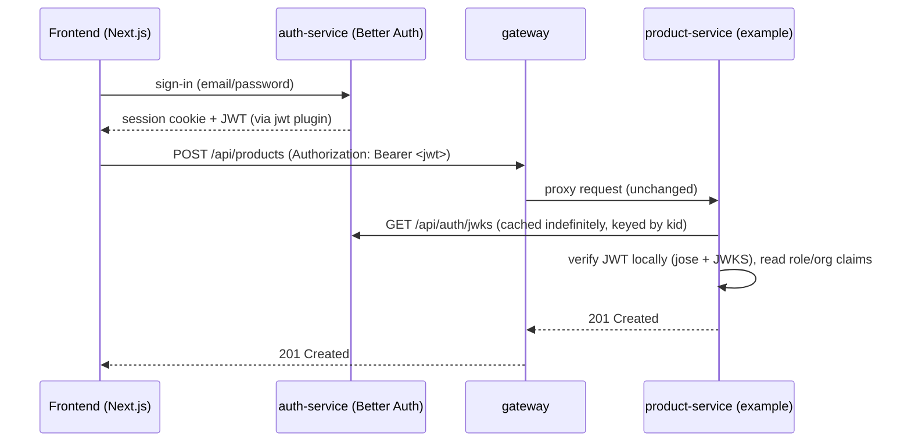
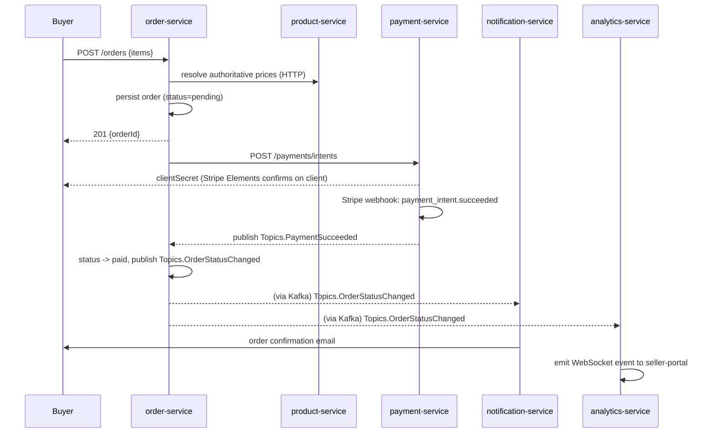

# Architecture

See `docs/PRD.md` for the phased roadmap and `docs/adr/` for individual
decisions. This doc is the "how it all fits together" reference.

## System context

## Services

| Service | Responsibility | Datastore | Talks to Kafka? |
|---|---|---|---|
| `gateway` | Routes `/api/<x>/**` to the right service, rate limits, CORS | — | no |
| `auth-service` | Identity, RBAC, organizations (Better Auth) | Postgres | no (yet) |
| `product-service` | Catalog, inventory | MongoDB | producer |
| `seller-service` | Store onboarding, Stripe Connect account linkage | Postgres | producer |
| `order-service` | Cart → order state machine, multi-vendor splitting | Postgres | producer |
| `payment-service` | Stripe PaymentIntents, webhooks, payout ledger | Postgres | producer |
| `notification-service` | Fans out to email/SMS/push | — | consumer |
| `media-service` | Signed direct-upload params for ImageKit | — | no |
| `analytics-service` | Kafka → WebSocket bridge for live dashboards | — | consumer |
| `recommendation-service` *(Tier 5, not built)* | ML-based product recommendations | — | consumer |

## Auth flow (cross-service)

The gateway never decodes the JWT — it only routes + rate-limits. Every
service is independently responsible for authz, using
`@betterbasket/auth-shared`'s `JwtAuthGuard` / `@Auth(...roles)`.

## Order → payment event flow (Tier 2/3)

## Event catalog

Defined in `packages/contracts/src/events/`. Every event is versioned in its
topic name (`.v1`) and validated with Zod at publish *and* consume time
(`packages/kafka-client`).

| Topic | Producer | Consumers | Payload |
|---|---|---|---|
| `user.registered.v1` | auth-service *(Tier 3)* | notification-service | `{ userId, email, role }` |
| `seller.onboarded.v1` | seller-service | notification-service, analytics-service | `{ sellerId, organizationId, stripeAccountId }` |
| `product.created.v1` | product-service | analytics-service | `{ productId, sellerId, title }` |
| `product.stock-changed.v1` | product-service | order-service *(future)*, analytics-service | `{ productId, variantId, newStock }` |
| `order.created.v1` | order-service | analytics-service, notification-service | `{ orderId, buyerId, total, sellerIds }` |
| `order.status-changed.v1` | order-service | notification-service, analytics-service | `{ orderId, previousStatus, newStatus }` |
| `payment.succeeded.v1` | payment-service | order-service, analytics-service | `{ orderId, paymentId, amount }` |
| `payment.failed.v1` | payment-service | order-service, notification-service | `{ orderId, reason }` |
| `payment.refunded.v1` | payment-service | order-service, notification-service | `{ orderId, paymentId, amount }` |
| `notification.requested.v1` | any service | notification-service | `{ userId, channel, template, data }` |

Dev/prod share one Redpanda Cloud cluster via `KAFKA_TOPIC_PREFIX`
(`dev.order.created.v1` vs `order.created.v1`) — see ADR 0004.

## API documentation

Every service exposes its own OpenAPI spec via `@nestjs/swagger` at
`/docs` (e.g. `http://localhost:4002/docs` for product-service). The gateway
also serves its own routing-level spec at `/docs`. `docs/api/` aggregates
links to all of them (see `docs/api/README.md`) — a Scalar/Redocly portal
gets wired up once there are enough real endpoints to be worth aggregating
(Tier 2+).

## Validation strategy

DTOs are Zod schemas in `packages/contracts`, not class-validator classes —
one source of truth shared between REST bodies, Kafka event payloads, and
(via `@betterbasket/contracts` imported in frontends) form validation. Each
service has a small local `ZodValidationPipe` (see
`apps/product-service/src/common/zod-validation.pipe.ts`) until it's worth
promoting to a shared package.

## What's intentionally not built yet

See `docs/PRD.md` for the full phased breakdown. In short: authoritative
price resolution in `order-service`, most Kafka event publishing (schemas
exist, most producers have `TODO(Tier N)` markers), the aggregated API docs
portal, and everything in Tier 5 (recommendations, real-time chat).
